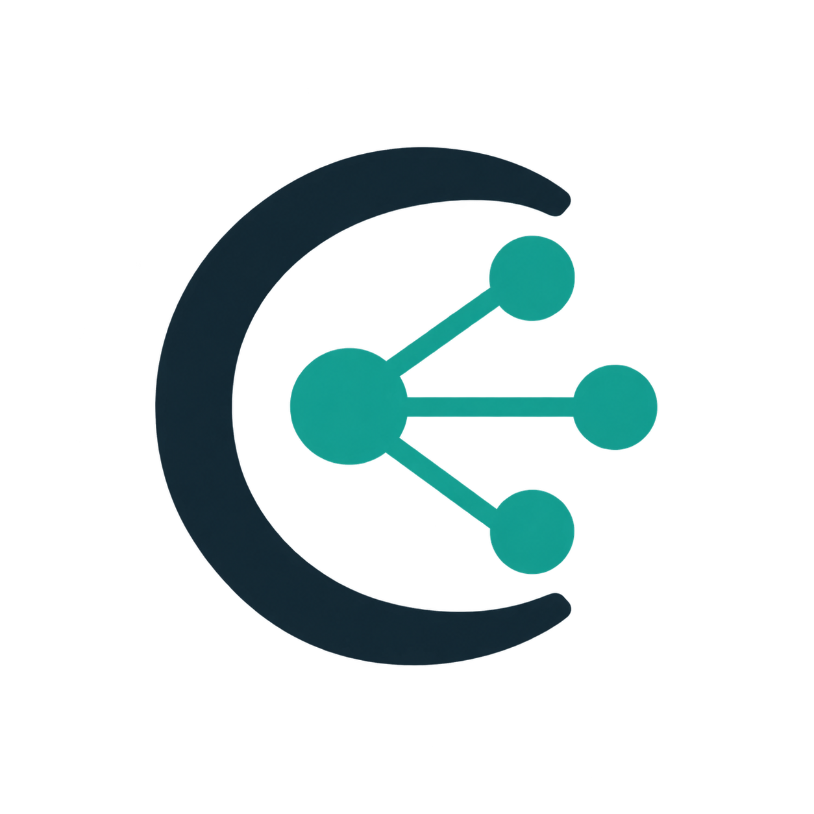

<p align="center">
  
</p>

<h1 align="center">Codex Control Claude</h1>

<p align="center">Codex에서 Claude Code 작업을 위임·관찰·검증하는 로컬 컨트롤러</p>

<p align="center">
  <strong>Linux · macOS 10.15+ · Windows 10/11</strong> · <strong>Python 3.10+</strong> · <strong>실행 시 외부 Python 의존성 없음</strong>
</p>

<p align="center">
  <a href="README.en.md">English</a> · 한국어 · <a href="docs/harness-v1.ko.md">하네스 안내</a> · <a href="docs/cli.ko.md">CLI 레퍼런스</a> · <a href="docs/architecture.ko.md">아키텍처</a> · <a href="CHANGELOG.md">변경 기록</a>
</p>

## 현재 버전: 0.28.0

Codex Control Claude는 **Codex 플러그인과 같은 호스트에서 실행하는 Python 컨트롤러**입니다.
두 실행 경로의 권한과 목적은 다릅니다.

1. **Linux 자율 하네스 (`harness`)**: 랩실에서 제공하는 `claude.ai` Team 조직으로
   로그인된 Claude Code CLI가 작업별 독립 Git clone을 직접 탐색·편집합니다. 컨트롤러는
   조직과 실행 파일을 고정하고, 제한된 도구·필수 Bash 샌드박스·실행 기록·커밋 SHA·
   격리 검사·명시적 승인을 관리합니다. 랩실 Team 구독 외 API 키나 다른 provider로
   대체하지 않습니다.
2. **기존 컨트롤러 (`start`, `delegate`, `task`, `workspace`, `workflow`,
   `composition`, `terminal`, `monitor`)**: 텍스트 위임과 단계별 검토를 제공합니다.
   비대화형 텍스트 작업은 Claude의 직접 파일·shell 도구와 MCP를 끈 상태로 실행합니다.
   파일 작업은 별도의 제한된 `workspace` 정책과 명시적 검사·적용 절차를 따릅니다.
   기존 schema 15 기록과 명령은 0.28에서도 유지됩니다.

두 경로 모두 **로컬 제어가 로컬 추론을 뜻하지는 않습니다.** 모델 요청은 로그인된
Claude 서비스에 전달됩니다. 하네스는 개인 Anthropic API 과금을 피하도록 인증 경로를
검증하지만, Team 조직에 사용량 크레딧이 설정되어 있으면 초과분이 조직에 과금될 수
있습니다. 자세한 계정 경계는 [하네스 사용 순서](#linux-자율-하네스-처음부터-승인까지)에
설명합니다.

### 핵심 기능

| 영역 | 현재 제공 기능 |
|---|---|
| 자율 저장소 작업 | Linux 하네스의 독립 clone, 제한된 `Read`·`Edit`·`Bash`, 컨트롤러 커밋, 정확한 SHA 증거, 별도 검사와 승인 |
| 워커 현황 | `harness agents`의 임무·상태·요청/관측 모델·토큰·경과 시간; `claude-worker-status` 스킬의 현재 Codex 대화 서브에이전트 병합 표시 |
| 대화와 작업 | 영속 Claude 세션, 역할별 모델·effort, 구조화 task 개정, 대기열·메시지·승인 근거 |
| 계획과 편집 | 별도 검토자가 있는 bounded workflow, 정책으로 제한한 workspace, 계획·편집·동결본 검토 composition |
| 관측 | Python TUI, Rust graph/replay viewer, 계정 한도, content-free 기본 원장·AG-UI·OpenTelemetry export, 선택적 로컬 상세 보기 |
| 대화형 조작 | Claude Code 네이티브 PTY/ConPTY terminal, 단일 조작자 attach, 별도 사용자 shell |

버전별 변경 내역은 [CHANGELOG.md](CHANGELOG.md)에, 세부 계약은
[CLI 레퍼런스](docs/cli.ko.md)와 [아키텍처](docs/architecture.ko.md)에 있습니다.

## 어떤 명령을 선택해야 하나요?

| 원하는 일 | 사용할 기능 | 추가되는 보장 |
|---|---|---|
| 랩실 Team Claude Code가 저장소를 직접 탐색·수정하게 하기 | `harness init/doctor/start` | Linux, 고정된 Team 조직·바이너리, 독립 clone, 제한된 도구와 필수 샌드박스 |
| 자율 수정 결과를 별도로 검사·승인하기 | `harness show/check/approve` | 깨끗한 작업 트리와 정확한 SHA, 격리된 검사 기록, 명시적 승인 |
| 실행 중인 Claude 작업과 현재 Codex 서브에이전트 보기 | `harness agents` + `$claude-control:claude-worker-status` | 읽기 전용 임무·상태·모델·토큰·경과 시간 스냅샷; 알 수 없는 값은 공란 |
| Claude에게 질문 한 번 보내기 | `start` | 지속 가능한 비정형 대화 세션 |
| 역할과 출력 형식을 정해 한 번 위임하기 | `delegate` | 역할 지침과 구조화된 보고서 검증 |
| 수정 요청과 최종 승인을 기록하기 | `task` | 불변 개정, 정확한 결과 해시, 기준별 승인 근거 |
| 계획을 만들고 별도 Fable에게 비평시키기 | `workflow` | 호출·수정·시간 예산이 고정된 P4 흐름 |
| Claude가 제한된 파일을 수정하게 하기 | `workspace` | Linux/Windows 전용 비공개 Git 사본, 정확한 쓰기 경로, 이름 있는 검사 |
| 계획부터 구현·검토까지 연결하기 | `composition` | Linux/Windows에서 P4 계획과 P5 편집·동결 검토의 명시적 연결 |
| 의존 작업을 순서대로 실행하기 | `task enqueue` + `dispatch` | FIFO 대기열과 정확한 부모 승인 조건 |
| 다음 턴에 전달할 지시를 저장하기 | `message` | 선택된 개정에만 전달되는 지시와 결과 인수인계 |
| multi-agent graph와 과거 실행 관찰하기 | `monitor viewer` | focus/recent/all graph, minimap, mouse camera, activity replay, agent별 실행 토큰 |
| 로컬 Claude/Codex 전사까지 상세 관찰하기 | `monitor viewer --local-detail` | mouse session picker, provenance/tool/activity 탭, 검색·prompt 이동; export와 분리 |
| 화면을 보며 Claude agent에 직접 입력하기 | `terminal start` + `monitor viewer --local-detail` | native PTY/ConPTY, 단일 조작자 lease, TERMINAL 탭과 ATTACH |
| 같은 project에서 직접 명령 실행하기 | `terminal shell` 또는 viewer의 `s` | agent 입력과 분리된 사용자 운영 shell, 허용 root 확인 |
| 계정 한도와 portable fallback 보기 | `monitor tui` / `monitor limits` | Codex·Claude·Gemini·Cursor quota와 Python-only 화면 |
| 계정에서 선택 가능한 모델 확인하기 | `models catalog` | 현재 selector·해석된 모델·지원 effort, 계정 식별자 제거 |
| 역할별 모델과 effort 바꾸기 | `models show/configure/reset` | 별칭·정확한 버전 ID, 원자적 설정 교체, 기존 작업 동결 |

### 운영체제별 지원 범위

| 기능 | Linux | macOS 10.15+ | Windows 10/11 |
|---|---|---|---|
| 기존 텍스트 위임·세션·task·workflow·관측 | 지원 | 지원 | 지원 |
| 자율 `harness` 파일 작업 | **지원**: Bubblewrap와 `socat` 필요 | 미지원 | 미지원 |
| 기존 격리 `workspace`·composition 편집/검사 | Bubblewrap | 격리 backend 부재로 거부 | WSL2 내부 Bubblewrap, beta |
| 대화형 `terminal` | 네이티브 PTY | 네이티브 PTY | 네이티브 ConPTY helper |

`harness`의 상태·인증 고정·clone 계약은 기존 `workspace`와 별개입니다.
`harness init`은 기존 컨트롤러의 `init`을 대신하지 않으며, 기존 명령만
사용할 때는 아래 [호스트 초기화](#이-호스트-초기화)를 따릅니다.

Codex 앱에서 사용할 때는 설치된 `$claude-control` 스킬을 명시하면 됩니다.
직접 상태를 확인하거나 운영하려면 아래 CLI를 사용하세요.

```bash
claude_control monitor viewer
claude_control monitor viewer --tree
claude_control monitor viewer --local-detail
claude_control monitor viewer --detail-current
claude_control monitor tui
claude_control monitor limits
claude_control monitor agui stream --after 0 --limit 100
```

대화형 agent를 새로 만들 때는 고유한 request ID를 사용합니다. terminal은 입력을
기다리는 빈 화면으로 시작하며, attach한 사용자가 직접 첫 지시를 입력합니다.

```bash
claude_control terminal start \
  --name interactive-editor \
  --role executor \
  --project /absolute/project \
  --request-id terminal-editor-001
claude_control terminal list
claude_control terminal logs --id <8-character-id> --bytes 8192
claude_control terminal attach --id <8-character-id>
claude_control terminal stop --id <8-character-id>
claude_control terminal shell --project /absolute/project
```

마우스·키보드 조작과 토큰 수치의 의미는 [실시간 모니터 안내](docs/monitor.ko.md)를
참고하세요.

역할별 모델과 effort 설정 파일, 정확한 버전 고정, 개별 assignment 덮어쓰기는
[모델 설정 안내](docs/models.ko.md)를 참고하세요.

## 안전 경계

- 한 설치본은 **같은 호스트, 같은 운영체제 사용자**의 Claude Code만
  관리합니다.
- 기존 비대화형 텍스트 위임의 Claude 기본 도구와 MCP는 비활성화됩니다.
  텍스트 작업에서 경로를 언급해도 Claude가 그 파일을 직접 읽을 수 없습니다.
- 선택형 Linux `harness`에는 별도 프로필을 사용합니다. `Read`·`Edit`·샌드박스
  안의 `Bash`만 허용하고, Claude Code의 `--restricted`, 작업 디렉터리 밖 읽기
  제한, `failIfUnavailable=true`와 샌드박스 밖 재시도 금지를 적용합니다.
  `harness doctor`가 준비되지 않으면 모델 실행을 시작하지 않습니다.
- `terminal start`도 safe mode, 빈 setting source, 빈 MCP와 native tool 비활성화
  정책을 사용합니다. attach는 agent 대화 입력용입니다. `terminal shell`은 사용자가
  직접 운영하는 별도 shell이므로 그 shell의 명령과 파일 변경은 사용자의 책임이며
  controller workspace 격리나 승인 경로를 통과하지 않습니다.
- 다른 도구가 만든 Claude session은 상태 목록에서만 관측합니다. controller가 만든
  safe-profile terminal만 화면 본문, attach와 stop을 허용합니다.
- 두 파일 작업 경로 모두 커밋된 Git 트리의 비공개 사본을 사용하며 원본을
  자동 변경하지 않습니다. 하네스는 원본과 Git 메타데이터를 공유하지 않는
  독립 clone을 만들고 remote를 제거합니다.
- 기존 `workspace` 검사는 정책에 미리 등록한 이름으로만 요청합니다.
  하네스의 독립 검사는 운영자가 정한 JSON argv를 별도 Bubblewrap에서 실행합니다.
  두 경우 모두 검사 결과만으로 원본 파일이 적용되지는 않습니다.
- 모델 실행 완료, 검토 권고, Codex 승인은 서로 다른 상태입니다.
- 실패·시간 초과·잘못된 보고서·실행 불명 상태는 자동 재시도하지 않습니다.
- 상주 스케줄러가 없습니다. `workflow run`, `workspace run`,
  `composition run`, `dispatch`를 명시적으로 호출해야 다음 단계가 진행됩니다.
- 프롬프트, 응답, 세션 ID와 실행 상태는 플러그인 소스와 별도 위치에
  저장됩니다.
- 하네스는 `claude.ai` Team 로그인과 고정된 조직·실행 파일을 요구하며 API 키와
  provider 우회 환경 변수를 자식에게 전달하지 않습니다. 조직이 랩실 소유인지의
  확인과 Team 사용량 크레딧 설정은 운영자의 책임입니다.

로컬 제어가 로컬 추론을 뜻하지는 않습니다. Claude Code는 기존 로그인으로
Claude 서비스에 모델 요청을 보냅니다.

## 준비 사항

### 공통

- Linux, macOS 10.15 이상 또는 Windows 10/11
- Python 3.10 이상
- 같은 사용자로 설치하고 로그인한 Claude Code
- 플러그인 기능과 `plugin-creator` 도구가 포함된 Codex CLI
- 설치 시 플러그인 검증에 사용할 PyYAML 포함 Python 3.10+

컨트롤러 실행 자체는 Python 표준 라이브러리만 사용합니다. 설치기는 빠진
패키지를 자동으로 설치하지 않습니다.

### Linux workspace와 composition

- Git
- Bubblewrap (`bwrap`)
- 사용할 수 있는 비특권 user, PID, network namespace

### Linux 자율 하네스

- Git과 Claude Code 2.1.248 이상
- 랩실에서 제공하는 `claude.ai` Team 조직에 로그인된 Claude Code CLI
- Bubblewrap (`bwrap`), `socat`, 사용 가능한 비특권 namespace
- 원본 Git 저장소의 커밋된 기준점과 task 기록·clone을 둘 개인 상태 디렉터리

`socat`이 시스템 `PATH`에 없다면 신뢰할 수 있는 사용자 영역 실행 파일의 절대
경로를 `harness init --socat-bin`에 전달할 수 있습니다. 플러그인은 의존성을
자동 설치하지 않습니다. `harness doctor`가 `ready: true`가 될 때만 시작합니다.

### Windows

- 아키텍처가 일치하는 `ccc-win-supervisor.exe`와 배포자가 제공한 SHA-256
- workspace와 composition에는 WSL2와 WSL 배포판 내부의 `bwrap`
- WSL workspace 상태를 둘 `/mnt` 밖의 private ext4 경로

Windows 네이티브 세션만 사용할 때는 WSL2가 필요하지 않습니다. 자세한 설치와
지원 범위는 [Windows 안내](docs/windows.ko.md)를 참고하세요.

### macOS

- Intel 또는 Apple Silicon Mac
- `/bin`·`/usr/sbin`의 기본 `ps`, `sysctl`, `ioreg`
- viewer를 직접 빌드할 때만 Rust 1.88 이상

macOS는 세션 제어와 관측 기능을 지원하지만 격리된 workspace 실행은 지원하지
않습니다. 정확한 지원표와 검증 명령은 [macOS 안내](docs/macos.ko.md)를 참고하세요.

첫 편집 전에 `workspace doctor`를 실행하세요. 격리를 사용할 수 없으면
workspace 실행을 거절하며, 격리 없는 대체 경로는 없습니다.

지원 모델 별칭은 `sonnet`, `opus`, `haiku`, `fable`입니다. 정확한
`claude-...` ID와 `[1m]` selector도 설정할 수 있습니다. 실제 사용 가능 여부는 Claude
계정에 따라 달라집니다. 선택한 모델을 쓸 수 없을 때 다른 모델로 조용히
바꾸지 않습니다.

## 설치

```bash
git clone https://github.com/kimstitute/codex-control-claude.git
cd codex-control-claude
python3 install.py
```

Windows에서는 helper의 SHA-256을 먼저 확인하고 함께 설치합니다.

```powershell
$sha = (Get-FileHash .\ccc-win-supervisor.exe -Algorithm SHA256).Hash.ToLower()
py -3 install.py --windows-helper .\ccc-win-supervisor.exe --windows-helper-sha256 $sha
```

Graph/replay viewer는 릴리스 바이너리 또는 직접 빌드한 바이너리의 hash를 함께
지정합니다. 설치기가 네트워크에서 바이너리를 받거나 다른 platform 파일로
대체하지 않습니다.

```bash
cargo build --locked --release --manifest-path viewer/Cargo.toml
viewer_sha=$(sha256sum viewer/target/release/ccc-viewer | cut -d' ' -f1)
python3 install.py --update \
  --viewer viewer/target/release/ccc-viewer \
  --viewer-sha256 "$viewer_sha"
```

macOS에서는 hash 줄만 `viewer_sha=$(shasum -a 256 viewer/target/release/ccc-viewer | awk '{print $1}')`로 바꿉니다.

viewer를 직접 빌드할 때만 Rust 1.88 이상이 필요합니다. 조작법, offline JSONL 재생,
headless inspect와 Windows 명령은 [실시간 모니터 안내](docs/monitor.ko.md)에 있습니다.

Windows helper가 없거나 해시가 다르면 설치 또는 Windows session control이 fail-closed로
중단되며 다른 실행 경로로 대체되지 않습니다.

설치기는 다음 작업을 수행합니다.

1. 플러그인 구조와 스킬을 검증합니다.
2. 소스를 `$HOME/plugins/claude-control`에 복사합니다.
3. 개인 Codex marketplace에 등록합니다.
4. 캐시 구분자가 붙은 설치본을 Codex에 설치합니다.

실행 상태는 플러그인 디렉터리에 저장하지 않습니다. 도구 위치가 기본값과
다르면 명시하세요.

```bash
python3 install.py \
  --plugin-creator-root /absolute/path/to/plugin-creator \
  --helper-python /absolute/path/to/python-with-pyyaml
```

설치 후 새 Codex 작업을 열어야 새 스킬을 확실히 불러옵니다.

## 이 호스트 초기화

Claude 실행 파일을 찾고, 컨트롤러가 사용할 수 있는 프로젝트 루트를
정합니다.

```bash
command -v claude

python3 "$HOME/plugins/claude-control/scripts/claude_control_cli.py" init \
  --claude-bin /absolute/path/to/claude \
  --allow-root /srv/my-project \
  --max-parallel 2 \
  --max-queued 100
```

여러 프로젝트 루트를 허용하려면 초기화할 때 `--allow-root`를 반복합니다.
이후 assignment의 `project`는 허용된 루트 안에 있어야 합니다.
`--claude-bin`에는 가능하면 `~/.local/bin/claude`처럼 설치기가 갱신하는 stable symlink를
지정하세요. 컨트롤러는 실제 version binary를 고정해 실행하고, 그 파일이 사라진 경우에만
동일한 versions directory를 가리키는 launcher를 검증해 새 작업용 경로를 원자적으로 복구합니다.
기존 대화는 자동으로 새 binary에 재개되지 않습니다.

설치, 로그인과 격리 환경을 확인합니다.

```bash
python3 "$HOME/plugins/claude-control/scripts/claude_control_cli.py" doctor --auth
python3 "$HOME/plugins/claude-control/scripts/claude_control_cli.py" workspace doctor
```

`doctor --auth` 결과에는 계정 식별자가 포함되지 않습니다. 정상 상태는
`"ready": true`로 표시됩니다. 로그인 계정에 제공되는 모델과 effort는 모델 추론을
호출하지 않는 `models catalog`로 확인합니다. 실제 작업 호출의 모델 ID는 기존처럼
실행 결과에서 다시 검증합니다.

아래 shell 함수를 정의하면 이후 예시를 그대로 사용할 수 있습니다.

```bash
claude_control() {
  python3 "$HOME/plugins/claude-control/scripts/claude_control_cli.py" "$@"
}
```

공개 운영 명령은 JSON을 출력합니다.

## Codex 앱에서 사용하기

새 Codex 작업에서 작업 내용과 스킬을 함께 말하면 됩니다.

> $claude-control을 사용해줘. 이 저장소에서 랩실 제공 Claude Code Team 조직으로
> 로그인된 Linux 하네스를 확인하고, 명세에 따라 독립 clone에서 구현해줘.
> 결과 diff와 별도 검사를 확인한 뒤 정확한 SHA만 승인해줘. 원본에는 자동으로
> 반영하지 마.

> $claude-control:claude-worker-status를 사용해 지금 실행 중인 Claude 하네스 워커와 이 Codex
> 대화의 서브에이전트 임무·상태·모델·토큰·경과 시간을 한 번에 보여줘.

하네스 예시는 반드시 본인이 접근할 수 있는 **랩실 Team 조직**과 Linux
샌드박스를 확인한 뒤 사용합니다. 이어지는 예시는 기존 도구 없는 명령의
역할별 위임·composition입니다.

> $claude-control을 사용해줘. Sonnet에게 범위가 고정된 구현을 맡기고,
> 별도 Fable 세션이 결과를 검증하게 해줘. 두 세션 ID를 보존하고 정확한
> 결과를 확인하기 전에는 승인하거나 적용하지 마.

0.11의 전체 흐름을 사용하려면 다음처럼 요청할 수 있습니다.

> 이 저장소에서 $claude-control composition을 사용해줘. Fable이 계획을
> 검토한 뒤 명시적 계획 승인을 기다리고, Sonnet은 허용된 파일만 수정하고
> 이름 있는 검사를 실행하게 해줘. 편집 결과를 동결한 뒤 별도 읽기 전용
> Fable 검토를 만들고, merge나 push는 자동으로 하지 마.

Codex는 세션 ID, 결과 해시, 승인 근거를 관리해야 합니다. Claude 프로세스가
정상 종료했다는 사실만으로 답의 정확성이 증명되지는 않습니다.

## Linux 자율 하네스: 처음부터 승인까지

이 경로는 **랩실이 제공하는 Claude Code Team 로그인**을 사용해 Claude가 저장소를
직접 읽고 고치게 할 때 선택합니다. 기존 `start`·`delegate`의 텍스트 전달이나
`workspace`의 파일별 정책을 그대로 확장한 명령이 아닙니다. `harness`는 별도의
상태 디렉터리와 도구 프로필을 가지며, Linux에서만 실행됩니다. 이 절의
`claude_control`은 위에서 정의한 shell 함수를 뜻합니다. 기본 상태 디렉터리의
`harness/`를 사용하고, 위치를 직접 지정할 때는 **모든 명령에서 동일한**
`--state-dir /absolute/private-state`를 `harness` 앞에 둡니다.

### 1. 계정·의존성 확인과 초기화

먼저 Claude Code에서 **현재 선택된 Team 조직이 랩실 제공 조직인지 운영자가
직접 확인**합니다. 프로그램은 `claude.ai`, `firstParty`, Team 구독과 조직 ID의
일치 여부를 확인하고 조직 ID의 해시만 고정합니다. 조직의 소유 주체를
알아내거나 계정·조직 이름을 출력하지는 않습니다. `ANTHROPIC_API_KEY` 등 API
인증 변수나 Bedrock·Vertex·Foundry provider 선택 변수는 자식 프로세스에
넘기지 않습니다. 다른 로그인 조직·바뀐 Claude 바이너리·샌드박스 실패는
모델 호출 전에 거절됩니다.

```bash
claude auth status
claude_control harness init --claude-bin /absolute/path/to/claude
claude_control harness doctor
```

시스템 `socat`이 없다면 `init`에 `--socat-bin /absolute/path/to/socat`을 추가합니다.
선택한 실행 파일의 신원도 고정됩니다. `doctor`의 `ready: true`와
`sandbox.ready: true`를 확인하세요. `doctor`는 Linux, Claude 실행 파일·로그인
조직, `bwrap`, `socat`과 실제 Bubblewrap probe를 확인합니다. 준비되지 않았을 때
비격리 실행으로 넘어가지 않습니다. 이미 초기화된 하네스에서 조직·바이너리를
바꾸는 `init --rebind`는 **기존 task가 없을 때만** 허용됩니다. 운영 중인 task를
우회하기 위해 다른 상태 저장소를 만드는 방식으로 사용하지 마세요.

하네스의 인증 확인은 개인 API 과금 경로를 차단하지만, Team 조직의 관리자가
사용량 크레딧을 켰다면 좌석 포함량 이후 사용이 **조직 크레딧**으로 청구될 수
있습니다. 프로그램은 관리자 과금 설정을 읽거나 바꾸지 않습니다. 추가 지출까지
막아야 한다면 랩실 관리자에게 크레딧·지출 한도를 확인받으세요.
[Anthropic의 Team 사용량 크레딧 안내](https://support.claude.com/en/articles/12005970-manage-usage-credits-for-team-and-seat-based-enterprise-plans)에
설정 방식이 설명되어 있습니다. `provider_cost_usd`는 Claude가 보고한 사용량
추정치로, 사용자의 개인 청구액이 아닙니다.

### 2. 작업 명세와 기준 커밋 준비

원본 저장소의 **커밋된 트리**에서 시작합니다. 미커밋 변경과 추적되지 않는
파일은 clone에 들어가지 않으므로, 필요한 입력은 먼저 커밋하거나 명세에
포함하세요. 명세는 UTF-8 텍스트 1~65,536바이트여야 하며 첫 번째 비어 있지
않은 줄이 워커 현황의 짧은 `mission` 표제가 됩니다. 목표, 변경 범위, 완료
기준, 실행 가능한 검사를 적어 두면 결과를 검토하기 쉽습니다.

```bash
git -C /srv/my-project status --short
git -C /srv/my-project rev-parse HEAD

cat > /tmp/ledger-task.md <<'EOF'
장부 합계 계산의 중복 집계 수정

- 현재 저장소에서 원인을 찾고 관련 구현과 회귀 테스트를 수정한다.
- 기존 공개 동작을 유지하고, 변경 이유와 수행한 검사를 마지막에 보고한다.
- git commit이나 git push는 실행하지 않는다.
EOF
```

### 3. 한 턴 실행하고 결과 확인

```bash
claude_control harness start \
  --repo /srv/my-project \
  --spec-file /tmp/ledger-task.md \
  --model sonnet \
  --base HEAD \
  --timeout 1800 \
  --request-id ledger-fix-001

claude_control harness show --task TASK_UUID
```

`start`는 동기 호출이며 제한 시간은 1~7,200초, 기본값은 1,800초입니다.
`--base`는 실행 시 정확한 Git 커밋으로 해석됩니다. 컨트롤러는 원본과 Git
메타데이터를 공유하지 않는 `--no-local --no-hardlinks` clone을 만들고 remote를
제거합니다. Claude Code는 `--restricted` 아래에서 `Read`, `Edit`, `Bash`만 사용하고
최대 30번의 Claude 턴 동안 탐색·편집·가능한 자체 검증을 진행합니다. Bash는
필수 샌드박스에서 실행되며 샌드박스 밖 재시도는 허용되지 않습니다. 성공한
실행의 변경은 **컨트롤러가 clone 안에 커밋**합니다. 결과가 없거나 검증되지
않은 턴은 `ready`로 인정하지 않습니다. 이벤트 스트림이 16MiB를 넘거나
제한 시간이 지나면 실행을 중단하고 원인을 기록합니다.

같은 `--request-id`와 같은 저장소·기준 SHA·모델·명세·제한 시간으로 다시
호출하면 기존 task를 재사용합니다. 이미 실행을 시작한 task라면 현재 기록을
반환합니다. 같은 ID로 입력을 바꾸면 `request_conflict`로
거절합니다. 네트워크나 호출 응답이 불명확할 때 중복 작업을 만드는 일을 막기
위한 계약입니다. 새 작업에는 새 ID를 사용하세요.

`show`의 주요 필드는 다음과 같습니다.

| 필드 | 확인할 내용 |
|---|---|
| `id`, `status`, `model`, `clone` | task ID, 현재 상태, 요청한 모델, 독립 clone 경로 |
| `base_sha`, `evidence.head_sha` | 시작 커밋과 컨트롤러가 기록한 결과 커밋 |
| `evidence.changed_files`, `evidence.diffstat` | 변경 파일과 diff 규모 |
| `evidence.clean`, `evidence.remotes` | 커밋 뒤 깨끗한 작업 트리와 remote 부재 |
| `evidence_current` | 지금의 clone이 저장된 증거와 여전히 같은지 여부 |
| `last_turn.actual_models`, `last_turn.errors`, `report` | 관측된 모델, 실행·검증 오류, Claude의 짧은 보고 |

`status: ready`이고 `evidence_current: true`여도 내용을 직접 읽고 확인해야
합니다. 예를 들어 반환된 `clone`, `base_sha`, `head_sha`를 사용해
`git -C CLONE_PATH diff BASE_SHA HEAD_SHA`를 실행합니다. clone에서 새 remote,
외부 경로로 빠지는 심볼릭 링크, 미커밋 변경, 모델·세션 불일치가 발견되면
승인 가능한 완료로 취급하지 않습니다. 현재 하네스는 원본 브랜치에 파일을
자동 적용하거나 merge·push하지 않습니다.

### 4. 같은 작업 이어가기 또는 불명 실행 정리

```bash
claude_control harness followup \
  --task TASK_UUID \
  --spec-file /tmp/ledger-followup.md \
  --timeout 1800

claude_control harness reconcile --task TASK_UUID
```

`followup`은 승인 전 task의 **같은 독립 clone과 Claude 세션**을 이어 갑니다.
후속 턴이 시작되면 앞선 검사 기록은 무효화되므로 최신 head를 다시 확인하고
검사해야 합니다. `approved` task에는 더 이상 후속 턴을 붙일 수 없습니다.
실패한 첫 턴에서 Claude 세션을 재개할 수 없는 경우에만
`followup --restart-session`으로 같은 clone에서 새 Claude 대화를 명시적으로
시작합니다.

호출 프로세스가 사라져도 task가 `running`으로 남았다면 `show`와 이벤트·
stderr를 조사하세요. `reconcile`은 기록된 프로세스가 실제로 살아 있으면
거절하고, 사라진 경우에만 `unknown`으로 바꿉니다. 결과가 불명확한 턴은
자동 재시도하지 않습니다. 상황을 검토한 뒤에만
`followup --acknowledge-unknown`을 사용합니다. `needs_attention`에는 모델 실패,
시간 초과, 출력 한도 초과, 불완전하거나 안전하지 않은 변경 등이 포함될 수
있으며, 원인을 확인한 뒤 새 지시를 작성해야 합니다. 원본 이벤트와 표준 오류는
기본 상태 디렉터리의 `harness/tasks/TASK_UUID/turn-N.jsonl` 및
`turn-N.stderr`에 남고 clone은 같은 task 디렉터리의 `work/`에 있습니다.

### 5. 별도 샌드박스에서 검사하고 정확한 SHA 승인

Claude가 자체 검사를 했더라도 **운영자가 선택한 검사**를 독립적으로 다시
돌릴 수 있습니다. 검사 파일은 shell 문자열이 아니라 실행 파일의 절대 경로와
리터럴 인수로 된 JSON 배열입니다. 첫 원소는 절대 경로여야 하고, 배열은
실행 파일을 포함해 최대 32개 원소, 파일은 최대 8,192바이트입니다. 예시의
Python 경로와 검사는 프로젝트 환경에 맞게 바꾸세요.

```bash
printf '%s\n' '["/usr/bin/python3", "-m", "unittest", "discover", "-s", "tests"]' \
  > /tmp/ledger-check.json

claude_control harness check \
  --task TASK_UUID \
  --argv-json /tmp/ledger-check.json \
  --timeout 300

claude_control harness show --task TASK_UUID
claude_control harness approve --task TASK_UUID --sha EXACT_HEAD_SHA
```

`check`는 `ready`이고 저장된 증거와 현재 clone이 정확히 같을 때만 실행됩니다.
기존 workspace 검사 엔진의 **네트워크 없는 Bubblewrap** 안에서 실행하고,
검사 전후의 head·작업 트리·remote·diff 증거를 비교합니다. `check.passed: true`와
`check.head_sha`가 승인할 SHA와 같은지 확인하세요. 기본 승인 명령은 이 통과
기록과 `--sha`의 정확한 일치를 요구합니다. 문서 작업처럼 독립 검사가
적용되지 않을 때는 diff를 검토한 후 `approve --task TASK_UUID --sha
EXACT_HEAD_SHA --accept-unchecked`로 검사 생략을 **명시적으로** 기록할 수
있습니다. 승인은 검토 기록일 뿐 원본 Git 저장소 반영 허가가 아닙니다.

### 6. 워커 현황과 Codex 서브에이전트 한 화면에 보기

```bash
claude_control harness agents
claude_control harness agents --all
```

첫 명령은 실행 중이거나 프로세스 생존 여부가 불명확한 하네스 작업을 보여
줍니다. `--all`은 완료·승인·주의 필요 작업까지 포함합니다. 읽기 전용으로
로컬 상태와 이벤트 파일만 읽으므로 Claude 모델을 호출하거나 상태를 새로
초기화하지 않습니다. `warnings`가 있으면 일부 기록을 읽지 못했을 수 있습니다.

| 필드 | 의미 |
|---|---|
| `mission`, `state`, `process_alive` | 최신 명세 첫 줄의 임무, task 상태, 실행 프로세스 관측 |
| `requested_model`, `actual_models` | 요청 모델과 Claude 이벤트에서 관측된 실제 모델 목록 |
| `started_at`, `elapsed_seconds` | 현재 또는 마지막 턴의 시작 시각과 경과 초 |
| `task_age_seconds` | 최초 턴부터 관측 시점까지의 task 나이 |
| `tokens.input_tokens` | 입력 토큰 |
| `tokens.cache_creation_input_tokens`, `cache_read_input_tokens` | 캐시 생성·읽기 입력 토큰 |
| `tokens.output_tokens`, `total` | 출력 토큰과 네 범주 합계 |
| `token_scope`, `counted_turns`, `turns` | 사용량의 완전성 및 집계된 턴 수 |

실행 중 사용량은 스트림에서 같은 메시지를 중복 계산하지 않은 **관측치**이며
`token_scope: provisional`로 표시됩니다. 모든 턴의 최종 `result` 사용량이 있으면
`final`입니다. `tokens: null`은 아직 계산할 자료가 없다는 뜻이며 0토큰을
의미하지 않습니다. `elapsed_seconds`는 현재/마지막 턴 기준이고
`task_age_seconds`는 첫 턴 이후의 경과 시간입니다.

Codex 앱에서는 **`$claude-control:claude-worker-status`** 스킬을 호출하면 이 결과와
`collaboration.list_agents`가 제공하는 **현재 대화의 Codex 서브에이전트**를
하나의 표로 정리합니다. Codex 도구가 모델·토큰·시작 시각을 제공하지 않으면
`—`로 두며, 없는 수치를 추정하거나 Claude 사용량에 합산하지 않습니다. 다른
Codex 대화의 에이전트는 조회하지 않습니다. 현재 하네스는 Claude 내부
`Agent` 도구를 허용하지 않으므로 `harness agents`의 워커는 최상위 Claude 작업을
가리킵니다. 명령 계약과 제한은 [하네스 v1 안내](docs/harness-v1.ko.md), 스킬의
표시 원칙은 [스킬 원문](plugins/claude-control/skills/claude-worker-status/SKILL.md)에
있습니다.

## 첫 CLI 실습: 대화 하나 시작하기

Claude에 전달할 내용을 `/tmp/claude-task.txt`에 작성합니다. `start`는 파일
권한을 주지 않으므로 필요한 코드나 근거는 프롬프트에 포함해야 합니다.

```bash
claude_control start \
  --name parser-review \
  --model sonnet \
  --effort medium \
  --role implementer \
  --project /srv/my-project \
  --prompt-file /tmp/claude-task.txt \
  --request-id parser-review-001 \
  --timeout 300
```

응답에서 다음 ID를 보관하세요.

| JSON 필드 | 의미 | 사용하는 명령 |
|---|---|---|
| `id` | 한 번의 실행 ID | `status`, `wait`, `logs`, `result`, `stop`, `reconcile` |
| `session_id` | 컨트롤러가 관리하는 대화 ID | `followup`, `resume`, `restart` |
| `backend_id` | Claude의 영속 대화 ID | 검증과 진단 전용 |

```bash
claude_control status --run <run-uuid>
claude_control wait --run <run-uuid> --seconds 30
claude_control logs --run <run-uuid> --stream stderr --bytes 8192
claude_control result --run <run-uuid>
```

세션이 idle이 된 뒤 정확한 대화를 이어갑니다.

```bash
claude_control followup \
  --session <managed-session-uuid> \
  --prompt-file /tmp/followup.txt \
  --request-id parser-review-002
```

`resume`은 `followup`의 별칭입니다. 세션의 모델과 effort는 고정됩니다.
각 논리 작업에는 고유한 request ID를 사용하세요. 같은 ID와 같은 입력을
다시 보내면 기존 결과를 반환하지만, 같은 ID에 다른 입력을 쓰면 거절합니다.

## 구조화된 단일 위임

역할 지침과 검증 가능한 보고서 형식이 필요하면 `delegate`를 사용합니다.
다음을 `/tmp/parser-review.json`으로 저장합니다.

```json
{
  "id": "parser-review",
  "name": "Parser review",
  "role": "critic",
  "model": "fable",
  "project": "/srv/my-project",
  "objective": "Review the supplied parser behavior for ambiguous inputs.",
  "context": "Paste the relevant requirements, source text and test evidence here.",
  "scope": ["Only the supplied parser and tests"],
  "acceptance_criteria": [
    "Identify concrete failure cases",
    "Separate verified facts from assumptions"
  ],
  "deliverable": "A concise review with regression-test proposals.",
  "effort": "high",
  "timeout": 300
}
```

```bash
claude_control roles
claude_control delegate \
  --assignment-file /tmp/parser-review.json \
  --request-id parser-review-delegate-001
claude_control wait --run <run-uuid> --seconds 30
claude_control report --run <run-uuid>
```

기본 역할 배치는 `executor`·`researcher`가 Sonnet,
`planner`·`architect`·`critic`·`verifier`가 Fable입니다. assignment에
`model`을 쓰면 해당 선택을 사용합니다. `report`는 ID와 형식을 검증하지만
내용을 승인하지는 않습니다.

## 전체 실습: 계획, 편집, 동결본 검토

중요한 저장소 변경에는 `composition` 흐름을 권장합니다.

### 1. 커밋된 트리 확인

Composition 생성 시 ref를 정확한 커밋으로 고정합니다. 원본 저장소의
미커밋 변경과 추적되지 않은 파일은 사본에 포함되지 않습니다.

```bash
git -C /srv/my-project status --short
git -C /srv/my-project rev-parse HEAD
mkdir -p /tmp/claude-composition
```

### 2. 계획 assignment 작성

`/tmp/claude-composition/plan.json`:

```json
{
  "id": "ledger-plan",
  "name": "Plan the ledger fix",
  "role": "planner",
  "model": "fable",
  "project": "/srv/my-project",
  "objective": "Produce a bounded implementation and test plan for the supplied ledger defect.",
  "context": "Paste the defect report, relevant source excerpts and constraints here. The planning stage cannot read repository paths directly.",
  "scope": ["src/ledger.py", "tests/test_ledger.py"],
  "acceptance_criteria": [
    "The plan names the exact files and behavior to change",
    "The plan defines a regression test and the named verification command"
  ],
  "deliverable": "A file-by-file implementation plan with risks and verification steps.",
  "effort": "high",
  "timeout": 600
}
```

계획 단계는 텍스트 위임입니다. `context`에 결함 설명, 관련 코드, 제약을
넣어야 하며 경로만 적는다고 파일을 읽지는 않습니다.

### 3. 편집 assignment 작성

`/tmp/claude-composition/editor.json`:

```json
{
  "id": "ledger-editor",
  "name": "Implement the ledger fix",
  "role": "executor",
  "model": "sonnet",
  "project": "/srv/my-project",
  "objective": "Implement the accepted plan in the controlled workspace.",
  "context": "Use only controller-mediated reads, full-file writes and named checks. The accepted plan provenance is appended by the composition.",
  "scope": ["src/ledger.py", "tests/test_ledger.py"],
  "acceptance_criteria": [
    "src/ledger.py implements the accepted behavior",
    "tests/test_ledger.py covers the regression",
    "The unit named check passes"
  ],
  "deliverable": "A complete workspace report with no pending operations.",
  "effort": "medium",
  "timeout": 600
}
```

### 4. 파일과 검사 권한 작성

`/tmp/claude-composition/editor-policy.json`:

```json
{
  "version": 1,
  "role": "executor",
  "read_paths": ["src/ledger.py", "tests/test_ledger.py"],
  "write_paths": ["src/ledger.py", "tests/test_ledger.py"],
  "checks": {
    "unit": {
      "argv": ["/usr/bin/python3", "-m", "unittest", "tests.test_ledger"],
      "timeout": 60
    }
  },
  "max_actions": 12,
  "max_calls": 6
}
```

쓰기 경로는 반드시 읽기 경로에도 있어야 합니다. 검사 실행 파일은
`/usr/bin/<이름>` 형태의 절대 경로여야 합니다. Claude는 `unit` 검사를
요청할 수 있지만 argv를 바꿀 수 없습니다.

### 5. 독립 검토 assignment 작성

`/tmp/claude-composition/reviewer.json`:

```json
{
  "id": "ledger-reviewer",
  "name": "Verify the frozen ledger fix",
  "role": "verifier",
  "model": "fable",
  "project": "/srv/my-project",
  "objective": "Independently assess the frozen editor result.",
  "context": "Review the frozen selected files and report evidence and limitations. Do not request writes or checks.",
  "scope": ["src/ledger.py", "tests/test_ledger.py"],
  "acceptance_criteria": [
    "src/ledger.py implements the accepted behavior",
    "tests/test_ledger.py covers the regression",
    "The unit named check passes"
  ],
  "deliverable": "A read-only verification report for Codex.",
  "effort": "high",
  "timeout": 600
}
```

검토자의 `acceptance_criteria`는 편집자의 기준과 정확히 같아야 합니다.
검토 정책은 컨트롤러가 자동으로 파생합니다. 읽기 경로만 같고 쓰기 경로와
검사는 비어 있습니다.

### 6. Composition 생성

```bash
claude_control composition create \
  --planning-assignment-file /tmp/claude-composition/plan.json \
  --editor-assignment-file /tmp/claude-composition/editor.json \
  --editor-policy-file /tmp/claude-composition/editor-policy.json \
  --reviewer-assignment-file /tmp/claude-composition/reviewer.json \
  --repo /srv/my-project \
  --ref HEAD \
  --operation-id ledger-composition-create-001 \
  --max-revisions 2 \
  --max-calls 6 \
  --dispatch-window-seconds 900 \
  --reviewer-effort high \
  --routing-metadata-file /tmp/claude-composition/routing.json
```

생성은 Git 커밋과 P4 workflow를 기록할 뿐 모델을 호출하지 않습니다.
반환된 composition UUID를 보관하세요.

리더가 직접 쓴 명세를 사용할 때는 `--planning-assignment-file` 대신
`--leader-spec-file`과 Fable `--critic-assignment-file`을 전달합니다. 선택적인
`--test-contract-file`은 editor binding 전 baseline 기대값을 확인하고, 동결한
테스트 경로가 그대로이며 모든 필수 검사가 최종 트리에서 통과했을 때만 reviewer를
엽니다. 전체 JSON 형식과 예제는 [composition 가이드](docs/compositions.ko.md)에
있습니다.

완료된 scout를 정확한 입력으로 재사용하려면 UUID 대신
`--scout-cache-assignment-file /tmp/claude-composition/scout.json`을 사용합니다.
일치하는 frozen 결과가 없으면 명시적으로 실패합니다. 여러 composition은 다음처럼
foreground dispatcher로 진행합니다.

```bash
claude_control composition dispatch --all --once
claude_control composition dispatch --all --until-idle --max-seconds 60
```

실제 기록의 성공률·비용과 라우팅별 차이는 다음과 같이 읽습니다.

```bash
claude_control composition evaluate --all
claude_control composition evaluate --composition <uuid> --composition <uuid>
claude_control composition evaluate --all --stratify risk_class --stratify editor_model
```

평가 명령은 원장을 변경하지 않으며, 누락된 비용이나 토큰을 추정하지 않습니다.

### 7. 계획 승인 지점까지 실행

```bash
claude_control composition run \
  --composition <composition-uuid> \
  --until-idle --max-seconds 60

claude_control composition status --composition <composition-uuid>
```

호출이 진행 중이었다면 상태를 확인한 뒤 같은 composition의 bounded run을
다시 실행합니다. 정상적인 첫 승인 지점은 다음과 같습니다.

```text
state:  awaiting_codex
reason: plan_acceptance_required
```

내부 workflow에는 `approve_recommended`가 표시되어야 합니다. 이는 검토
권고이며 승인 자체가 아닙니다.

### 8. 정확한 계획 결과 검토·승인

Composition status에 나온 계획 task와 run을 조회합니다.

```bash
claude_control task show --task <plan-task-uuid>
claude_control report --run <plan-run-uuid>
claude_control result --run <plan-run-uuid>
```

계획의 1부터 시작하는 모든 기준에 대해 근거를 기록한
`/tmp/claude-composition/plan-evidence.json`을 작성합니다.

```json
{
  "1": [{"type": "free_text", "text": "Codex verified the exact file and behavior boundaries."}],
  "2": [{"type": "free_text", "text": "Codex verified the proposed regression test and named check."}]
}
```

컨트롤러가 보여준 정확한 개정, run, 결과 해시를 사용합니다.

```bash
claude_control task accept \
  --task <plan-task-uuid> \
  --revision <plan-revision> \
  --run <plan-run-uuid> \
  --result-sha256 <plan-result-sha256> \
  --evidence-file /tmp/claude-composition/plan-evidence.json \
  --operation-id ledger-plan-accept-001
```

독립 계획 검토가 정확히 `approve_recommended` 상태가 아니면 composition이
이 승인을 거절합니다.

### 9. 편집과 동결본 검토 실행

```bash
claude_control composition run \
  --composition <composition-uuid> \
  --until-idle --max-seconds 60

claude_control composition status --composition <composition-uuid>
```

계획 승인 후, 생성 시 고정한 커밋으로 편집 workspace를 만듭니다. 편집이
끝나면 트리를 먼저 동결하고, 그 동결본으로 별도 읽기 전용 Fable 검토
workspace를 만듭니다. 다음 상태까지 bounded run을 이어갑니다.

```text
state:  awaiting_codex
reason: final_review_ready
```

여기까지 원본 저장소에는 어떤 파일도 자동 반영되지 않습니다.

### 10. 동결 증거 확인과 최종 승인

Composition status에 editor와 reviewer workspace UUID, 정확한 결과 ID와
해시가 들어 있습니다. 두 결과를 모두 확인합니다.

```bash
claude_control workspace status --workspace <editor-workspace-uuid>
claude_control workspace export --workspace <editor-workspace-uuid>
claude_control workspace status --workspace <reviewer-workspace-uuid>
claude_control workspace export --workspace <reviewer-workspace-uuid>
claude_control report --run <reviewer-run-uuid>
```

편집자의 모든 기준을 다루는
`/tmp/claude-composition/editor-evidence.json`을 작성합니다.

```json
{
  "1": [{"type": "free_text", "text": "Codex inspected the frozen implementation against the accepted plan."}],
  "2": [{"type": "free_text", "text": "Codex inspected the frozen regression test."}],
  "3": [{"type": "free_text", "text": "Codex verified the recorded named-check receipt and reviewer evidence."}]
}
```

```bash
claude_control task accept \
  --task <editor-task-uuid> \
  --revision <editor-revision> \
  --run <editor-run-uuid> \
  --result-sha256 <editor-result-sha256> \
  --evidence-file /tmp/claude-composition/editor-evidence.json \
  --operation-id ledger-editor-accept-001

claude_control composition status --composition <composition-uuid>
```

`accepted` 상태는 정확한 편집 결과에 대한 승인 기록과 손상되지 않은
editor/reviewer export에서 파생됩니다. 동결 patch나 파일을 원본에 적용하는
일은 이후 Codex 또는 사용자가 별도로 수행합니다.

## Composition 상태 읽기

| 상태/이유 | 의미 | 다음 행동 |
|---|---|---|
| `active` | 명시적으로 진행할 단계가 남아 있음 | bounded `composition run` 한 번 실행 |
| `awaiting_codex/plan_acceptance_required` | 검토된 계획이 준비됨 | 정확한 계획 결과를 확인하고 명시적으로 승인 |
| `awaiting_codex/final_review_ready` | 편집과 동결본 검토가 완료됨 | 두 export를 확인하고 정확한 편집 결과 승인 |
| `awaiting_codex/final_review_revise` | reviewer가 기준 실패를 확인함 | revision 지시를 확인하고 새 편집 작업 결정 |
| `awaiting_codex/final_review_blocked` | reviewer에게 필수 근거가 부족함 | 누락된 근거를 보강하기 전에는 승인하지 않음 |
| `awaiting_codex/<failure>` | 실패·잘못된 보고서·예산·불확실성으로 자동화가 멈춤 | 해당 child를 조사하고 자동 대체 작업을 만들지 않음 |
| `accepted` | 정확한 편집 승인과 온전한 증거가 존재함 | 원본 반영 여부를 별도로 결정 |
| `stopping` | 소유한 실행과 명령을 정리하는 중 | `stop` 또는 `run`으로 정리를 계속한 뒤 확인 |
| `stopped` | 신규 실행이 막혔고 정리가 끝남 | 기록을 보존하거나 의도적으로 새 composition 생성 |

증거를 지우지 않고 composition을 중단할 수 있습니다.

```bash
claude_control composition stop \
  --composition <composition-uuid> \
  --operation-id ledger-composition-stop-001
```

## 파일 작업이 없는 Task 승인 흐름

파일 작업이 필요 없다면 다음 명시적 흐름을 사용합니다.

```text
task create → task submit → report/result → task review → task accept
                                      ↘ task revise → task submit
```

`task review`의 `approve`, `revise`, `blocked`는 검토 권고입니다. 실제 승인은
`task accept`만 만들 수 있으며, 정확한 task 개정, run ID, 결과 SHA-256,
모든 기준의 근거가 필요합니다. 자세한 내용은 [작업 가이드](docs/tasks.ko.md)를
참고하세요.

## 병렬 실행, 대기열, 다음 턴 메시지

이미 시작한 여러 실행을 함께 관찰할 수 있습니다.

```bash
claude_control observe \
  --run <first-run-uuid> \
  --run <second-run-uuid> \
  --seconds 30
```

Task를 대기열에 넣고 준비된 작업을 명시적으로 배정합니다.

```bash
claude_control task enqueue \
  --task <task-uuid> --revision 1 \
  --operation-id enqueue-task-001

claude_control dispatch --until-idle --max-seconds 60
```

부모 task는 정확한 Codex 승인을 받아야 의존 조건을 만족합니다.
`message enqueue`로 이후 지시를 저장하고 `task revise`에서 message ID를
선택한 다음 새 개정을 별도로 제출합니다. [대기열](docs/queue.ko.md)과
[메시지·인수인계](docs/messages.ko.md)를 참고하세요.

## 중단과 복구

한 실행의 취소를 요청하고 실제 종료 상태를 확인합니다.

```bash
claude_control stop --run <run-uuid>
claude_control wait --run <run-uuid> --seconds 30
```

`unknown`은 실행이 아직 존재할 가능성을 뜻하므로 동시 실행 슬롯을 계속
차지합니다. 로그와 기록을 확인한 뒤, 원래 실행의 PID namespace에서 같은
run을 reconcile합니다.

```bash
claude_control status --run <run-uuid>
claude_control logs --run <run-uuid> --stream worker --bytes 8192
claude_control reconcile --run <run-uuid>
```

불확실성을 피하려고 DB를 지우거나 다른 state store를 초기화하거나 대체
세션을 만들면 안 됩니다. 실패·취소된 대화도 입력 일부를 읽었을 수 있으므로
확인 후 필요한 context acknowledgement를 명시해 후속 턴을 만드세요.

## 상태 저장소와 여러 호스트

기본 상태 경로는 운영체제에 따라 다릅니다.

| 운영체제 | 기본 경로 |
|---|---|
| Linux | `$XDG_STATE_HOME/claude-control` 또는 `$HOME/.local/state/claude-control` |
| macOS | `$XDG_STATE_HOME/claude-control` 또는 `$HOME/Library/Application Support/codex-control-claude/state` |
| Windows | `%LOCALAPPDATA%\codex-control-claude\state` (`LOCALAPPDATA`가 없으면 `%USERPROFILE%\AppData\Local` 기준) |

설정, 프롬프트, 응답, 작업 이력, 프로세스 증거와 비공개 workspace를 이
저장소에 둡니다. Linux 하네스는 같은 기본 상태 디렉터리 아래의 별도
`harness/`에 고정 설정, task 기록, 작업별 clone과 이벤트·stderr 파일을
보관합니다. 하네스 디렉터리는 소유자 전용 권한을 요구하며 자동 정리하지
않습니다. 필요한 증거와 clone의 보존 기간은 운영자가 결정합니다.

다른 초기화된 저장소를 선택하려면 `--state-dir`을 subcommand 앞에 둡니다.

```bash
claude_control --state-dir /srv/controller-state list
```

각 호스트는 별도 상태 저장소와 Claude 로그인·세션 이력을 가집니다. 이
버전은 컴퓨터 사이에 작업을 전달하지 않습니다.

## 업데이트와 스키마 이관

관리 중인 실행을 끝내거나 중단하고, `unknown` 실행을 해결한 뒤 갱신합니다.

```bash
git pull --ff-only
python3 install.py --update
```

재설치 후 새 Codex 작업을 여세요. 이전 CLI와 worker가 모두 종료된 상태에서
새 CLI로 기존 저장소를 확인하고 이관합니다.

```bash
claude_control migrate --status
claude_control migrate --offline
claude_control migrate --status
```

새 저장소는 schema 15를 사용합니다. 기존 schema 3–14는 각 단계마다 검증된
SQLite 백업과 영속 migration journal을 만들면서 순서대로 이관됩니다.
중단되었다면 원래 상태 디렉터리에서 같은 `migrate --offline`을 다시
실행합니다. 백업 DB로 작업을 실행하거나 원본 DB를 단일 SQLite 파일
복사본으로 교체하지 마세요.

## 문제 해결

| 증상 | 의미와 조치 |
|---|---|
| `doctor`가 Claude 옵션 부족을 보고함 | 표시된 옵션을 지원하는 Claude Code로 갱신 |
| `doctor --auth`가 ready가 아님 | 일반 Claude Code 로그인 후 다시 검사 |
| 지정 모델 호출 실패 | 계정의 모델 사용 가능 여부 확인; 자동 대체 없음 |
| `project_not_allowed` | 초기화한 `--allow-root` 내부 경로 사용; 새 state store로 우회하지 않음 |
| Linux에서 `workspace doctor` 실패 | Bubblewrap 또는 비특권 namespace를 복구; 비격리 실행은 하지 않음 |
| `harness doctor`가 `ready: false` | `sandbox.reason`, `bwrap`, `socat` 경로와 바이너리 신원, 비특권 namespace를 확인; 비격리 대체 실행 없음 |
| `lab_subscription_required` / `lab_org_changed` | 랩실 제공 `claude.ai` Team 로그인과 고정된 조직을 확인; API 키나 개인 계정으로 우회하지 않음 |
| `claude_binary_changed` / `socat_binary_changed` | 고정한 실행 파일이 바뀐 이유와 기존 task를 확인; 기존 task가 있는 상태 저장소는 재고정할 수 없으므로 새 작업의 상태 저장소를 별도로 준비하고 기존 증거는 보존 |
| `request_conflict` | 같은 request ID에 입력이 달라짐; 기존 task를 확인하고 별도 작업에만 새 ID 사용 |
| `evidence_stale` / `check_required` | 최신 `show`의 head·작업 트리와 검사 결과를 확인; 정확한 SHA의 통과 검사 또는 명시적 `--accept-unchecked` 필요 |
| 하네스 task가 `running`으로 남음 | `show`로 프로세스 생존 여부 확인, 기록 조사 후 `reconcile`; 불명 결과는 `--acknowledge-unknown` 없이 재실행하지 않음 |
| macOS에서 `workspace doctor`가 비활성 보고 | 정상 동작; 지원되는 fail-closed sandbox backend가 없어 workspace와 composition 편집 단계를 실행하지 않음 |
| macOS에서 session control 비활성 | `doctor --platform`에서 `ps`, `sysctl`, `ioreg` 기본 도구 탐지 결과 확인 |
| Windows에서 session control 비활성 | 아키텍처에 맞는 `ccc-win-supervisor.exe`와 설치 시 고정한 SHA-256을 확인 |
| Windows에서 workspace 비활성 | WSL2, WSL 내부 `bwrap`, private ext4 상태 경로를 확인; `/mnt` 아래 상태는 거절됨 |
| `capacity_full` 또는 session busy | 기존 실행을 확인하고 기다리거나 소유 실행을 의도적으로 중단 |
| `context_changed` | 최신 정확한 턴을 확인하고 요구된 acknowledgement와 함께 명시적 개정/후속 턴 생성 |
| `unknown` | 원래 실행을 조사하고 reconcile; 자동 재시도·대체 금지 |
| `invalid_report` | `result` 원문 확인 후 새 명시적 개정에서 수정; 자동 repair 호출 없음 |
| `migration_required` | client/run 중단, `migrate --status` 확인, `migrate --offline` 실행 |
| 설치 시 `yaml` import 실패 | PyYAML이 있는 Python 3.10+를 `--helper-python`으로 지정 |

## 문서 안내

- [Linux Claude Code Team 자율 하네스](docs/harness-v1.ko.md)
- [워커 현황 스킬의 표시 원칙](plugins/claude-control/skills/claude-worker-status/SKILL.md)
- [CLI와 보고서 계약](docs/cli.ko.md)
- [Task 개정, 승인 근거와 migration](docs/tasks.ko.md)
- [대기열, 의존성, dispatch](docs/queue.ko.md)
- [다음 턴 메시지와 결과 인수인계](docs/messages.ko.md)
- [제한된 worker/reviewer workflow](docs/workflows.ko.md)
- [Workspace 정책과 격리](docs/workspaces.ko.md)
- [계획·편집·동결 검토 composition](docs/compositions.ko.md)
- [실시간 에이전트 모니터](docs/monitor.ko.md)
- [Effort와 실행 설정](docs/execution-settings.ko.md)
- [아키텍처와 신뢰 경계](docs/architecture.ko.md)
- [테스트와 선택적 live test](docs/testing.ko.md)
- [실제 프로젝트 파일럿 기록](docs/real-project-pilot.ko.md)
- [OMX에서 도입한 설계](docs/omx-adoption.ko.md)
- [macOS 설치와 지원 범위](docs/macos.ko.md)
- [Windows 설치와 운영](docs/windows.ko.md)
- [Windows 지원 설계 기록](docs/windows-support-plan.ko.md)

## 테스트

```bash
python3 -m unittest discover -s tests -v
ruff check .
ruff format --check .
```

일반 테스트는 가짜 Claude 프로세스를 사용하므로 모델을 호출하지 않습니다.
실제 Claude 계정을 쓰는 live test는 명시적으로 선택해야 하며,
[테스트 문서](docs/testing.ko.md)에 절차가 있습니다.

## 현재 범위

0.28.0은 Linux, macOS 10.15 이상과 Windows 10/11에서 텍스트 위임, 영속 세션,
검토·승인 가능한 task 개정, 유한 대기열과 workflow, 명시적
계획·편집·검토 composition, 다중 composition dispatch, 라우팅 출처와 평가,
검증된 scout 재사용, 역할별 모델·effort 설정, 계정 model catalog와 read-only
실시간 TUI와 native graph viewer를 지원합니다. Linux workspace는 네이티브
Bubblewrap, Windows workspace는 WSL2 내부 Bubblewrap을 사용합니다. macOS는
세션·관측·terminal을 지원하고 workspace와 composition 편집·검사는 fail-closed합니다.
Linux에서는 선택형 `harness`가 랩실 `claude.ai` Team 구독을 고정해 독립 clone의
자율 `Read`·`Edit`·샌드박스 `Bash`, 컨트롤러 커밋, 별도 검사와 정확한 SHA
승인을 제공합니다. 하네스 워커의 상태·사용량은 읽기 전용으로 조회하며,
Codex 스킬은 현재 대화의 서브에이전트 목록을 함께 보여 줍니다. 이 경로는
macOS·Windows에서 실행하지 않습니다.

기존 도구 없는 텍스트 위임에 Claude의 직접 파일·shell 권한을 추가하지
않았습니다. 임의 기존 세션 인수, 대화 fork, macOS native sandbox,
AppContainer, MCP adapter, 서버 간 전달, Codex 자동 깨우기, 하네스의
다중 호스트 큐·GPU 예약·자동 통합도 범위 밖입니다. macOS Python 코어는
결정적 단위 테스트와 macOS CI로 검증하며 실제 계정 호출은 사용자 Mac의
별도 smoke가 필요합니다. Windows 네이티브 helper, Job Object와 도구 없는
실제 Sonnet 호출은 실기기에서 통과했습니다. WSL2/Bubblewrap 최종 검증은
Codex sandbox의 WSL 서비스 `E_ACCESSDENIED` 때문에 일반 Windows 터미널
실행이 남아 있으므로 Windows workspace 지원은 beta입니다.

제작: [kimstitute](https://github.com/kimstitute). OpenAI 또는 Anthropic의
공식 연동 제품이 아닌 독립 프로젝트입니다.
